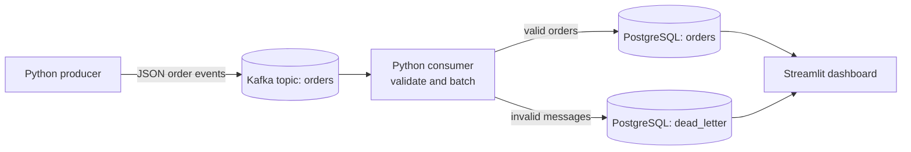

# Real-Time Data Pipeline Project Documentation

## 1. Project overview

This project is an end-to-end demonstration of a real-time data pipeline. It simulates e-commerce order activity, streams events through Apache Kafka, validates and stores them in PostgreSQL, and presents live analytics in a Streamlit dashboard.

The application is intended for learning and demonstration. It illustrates how a streaming system can move data from event generation to validation, persistent storage, and visualization using a containerized local environment.

## 2. Purpose and problem statement

Traditional batch reporting can leave teams looking at data that is minutes or hours old. This project demonstrates a streaming alternative in which events are continuously produced and processed, allowing dashboards and operational indicators to reflect incoming activity shortly after it occurs.

It also demonstrates why a streaming pipeline needs data-quality and delivery safeguards. Invalid events are recorded instead of silently discarded, and database writes are designed to tolerate duplicate delivery.

## 3. Project objectives

- Generate a continuous stream of realistic sample order events.
- Publish events to a Kafka topic for asynchronous processing.
- Validate each event against a defined data contract.
- Store valid orders and rejected messages in PostgreSQL.
- Make database writes idempotent and commit Kafka offsets only after database transactions succeed.
- Display live order, revenue, latency, and data-quality metrics.
- Package the system with Docker Compose so it can be run consistently on a developer machine.
- Provide tests for event validation, event generation, and alert logic.

## 4. Scope and assumptions

The producer generates synthetic data; this project does not connect to a real storefront or payment processor. The Compose deployment runs a single Kafka broker and a single PostgreSQL instance on one host. It is suitable for local development and demonstrations, but it does not provide production-grade high availability, authentication, or encrypted service-to-service traffic by default.

The dashboard reports on data stored in PostgreSQL. It does not provide event replay controls or an administrative interface for editing records.

## 5. System architecture



### Component responsibilities

| Component | Responsibility |
|---|---|
| Producer | Generates order events, serializes them as JSON, and publishes them to Kafka. It intentionally introduces a small percentage of invalid and duplicate messages for testing. |
| Kafka | Buffers events between the producer and consumer. The producer creates the topic with three partitions by default and keys messages by `user_id`. |
| Consumer | Reads Kafka messages in batches, validates each event, writes valid and invalid records to PostgreSQL, and commits Kafka offsets after the database transaction commits. |
| PostgreSQL | Persists validated orders and dead-letter records, and exposes a per-minute rollup view for analysis. |
| Dashboard | Queries PostgreSQL and displays KPIs, charts, recent orders, invalid messages, and operational alerts. |
| Docker Compose | Builds the Python application image and runs Kafka, PostgreSQL, producer, consumer, and dashboard as connected services. |

### Event lifecycle

1. The producer creates a sample order and serializes it as JSON.
2. The producer publishes it to Kafka, using the user ID as the message key. Some messages are deliberately corrupted; a small percentage are sent twice.
3. The consumer validates the message. Valid messages become order rows; invalid messages are stored with their payload and validation reason.
4. The consumer commits the database transaction, then commits the Kafka offsets. If the process stops before its Kafka commit, messages can be delivered again.
5. PostgreSQL uniqueness constraints make repeated writes safe: duplicate order IDs are ignored, and dead-letter records are unique by topic, partition, and offset.
6. The Streamlit dashboard queries the stored data and refreshes automatically.

## 6. Technology stack

| Area | Technology |
|---|---|
| Language | Python 3.12 |
| Streaming | Apache Kafka 3.8, KRaft mode |
| Database | PostgreSQL 16 |
| Dashboard | Streamlit, pandas, Plotly, SQLAlchemy |
| Kafka client | `confluent-kafka` |
| Database client | `psycopg2` |
| Containerization | Docker and Docker Compose |
| Tests | pytest |

## 7. Data model

### Order event

Each event must include the following fields:

| Field | Validation |
|---|---|
| `order_id` | Non-empty string, at most 64 characters |
| `user_id` | Positive integer |
| `product` | Non-empty string |
| `category` | One of `Electronics`, `Home`, `Fashion`, `Books`, `Sports`, or `Beauty` |
| `quantity` | Integer from 1 through 20 |
| `unit_price` | Number greater than 0 and no more than 10,000 |
| `country` | Two-letter alphabetic code; normalized to uppercase |
| `payment_method` | One of `card`, `upi`, `paypal`, `bank_transfer`, or `wallet` |
| `status` | One of `completed`, `pending`, or `cancelled` |
| `event_time` | ISO-8601 timestamp; timestamps more than five minutes in the future are rejected |

The total amount is calculated from quantity and unit price. PostgreSQL also records `ingested_at`, the time the event was stored.

### Database objects

- **`orders`** stores validated events. `order_id` is the primary key, supporting idempotent inserts.
- **`dead_letter`** stores invalid messages, including the Kafka topic, partition, offset, raw payload, rejection reason, and receive time.
- **`orders_per_minute`** is a PostgreSQL view that aggregates order counts, revenue, and average order value by event minute.

Revenue metrics exclude cancelled orders. The dashboard can still include pending and cancelled orders in order counts, depending on the metric.

## 8. Dashboard and alerts

The dashboard is available at `http://localhost:8501` when Compose is running. It provides:

- Order count, revenue, average order value, recent order volume, and invalid-message count.
- Average pipeline latency from event time to database ingestion.
- Revenue and order trends by minute.
- Revenue by category, top products, and order counts by country.
- A table of recent orders and an expandable view of recent dead-letter entries.
- A selectable reporting window and automatic refresh interval.

Alert rules are evaluated from the database data:

| Alert | Condition |
|---|---|
| Stream stalled | No new order has been ingested for more than 30 seconds |
| High invalid-message rate | Invalid messages exceed 10% of messages in the selected window |
| High pipeline latency | Average latency is greater than 10 seconds |
| Revenue drop | Revenue in the last five minutes is less than 50% of revenue in the previous five minutes |

## 9. Setup and run

### Prerequisites

- Docker Desktop on macOS or Windows, or Docker Engine and the Compose plugin on Linux.
- Git to clone the repository.

Python, Kafka, and PostgreSQL do not need to be installed on the host to run the full Compose stack.

### Start the project

```bash
git clone https://github.com/theyashkhatri/Real-Time-Data-Pipeline-with-Streaming-Ingestion-and-Live-Dashboard.git
cd Real-Time-Data-Pipeline-with-Streaming-Ingestion-and-Live-Dashboard
docker compose up -d --build
```

The first build may take several minutes. Verify service state:

```bash
docker compose ps
```

Kafka and PostgreSQL should report healthy before the dependent application services can run. On a first launch, Kafka can take up to about a minute to become ready. Open **http://localhost:8501** to view the dashboard.

### Stop and restart

Stop the containers while preserving the database volume:

```bash
docker compose down
```

Start them again:

```bash
docker compose up -d
```

To delete the database volume and all stored records as well as stop the services:

```bash
docker compose down -v
```

The volume deletion is permanent. Do not use `-v` if you want to keep the data.

## 10. Configuration

Compose reads optional overrides from a `.env` file in the project root. For example:

```dotenv
POSTGRES_USER=pipeline
POSTGRES_PASSWORD=replace-with-a-strong-password
POSTGRES_DB=analytics
EVENTS_PER_SECOND=5
INVALID_RATE=0.03
DUPLICATE_RATE=0.01
BATCH_SIZE=50
BATCH_TIMEOUT_SECONDS=2
KAFKA_TOPIC=orders
CONSUMER_GROUP=orders-processor
```

| Variable | Default | Description |
|---|---:|---|
| `POSTGRES_USER` | `pipeline` | PostgreSQL username |
| `POSTGRES_PASSWORD` | `pipeline` | PostgreSQL password; change it outside local development |
| `POSTGRES_DB` | `analytics` | PostgreSQL database name |
| `EVENTS_PER_SECOND` | `5` | Approximate producer rate; traffic varies over time |
| `INVALID_RATE` | `0.03` | Fraction of generated messages deliberately made invalid |
| `DUPLICATE_RATE` | `0.01` | Probability that a generated message is sent a second time |
| `BATCH_SIZE` | `50` | Maximum number of messages consumed in one batch |
| `BATCH_TIMEOUT_SECONDS` | `2` | Consumer wait time when filling a batch |
| `KAFKA_TOPIC` | `orders` | Kafka topic name |
| `CONSUMER_GROUP` | `orders-processor` | Consumer group name |

The default producer setting generates about five original events per second on average, with traffic varying roughly ±50%. It has no built-in maximum event count and continues until the producer is stopped.

## 11. Operations and common commands

```bash
docker compose ps                           # check service status
docker compose logs -f                      # follow all service logs
docker compose logs -f producer consumer    # follow event flow
docker compose logs --tail=100 dashboard    # inspect dashboard startup/errors
docker compose restart                      # restart the services
```

Count the current database rows:

```bash
docker compose exec postgres sh -c 'psql -U "$POSTGRES_USER" -d "$POSTGRES_DB" -c "SELECT (SELECT count(*) FROM orders) AS orders, (SELECT count(*) FROM dead_letter) AS dead_letters;"'
```

Open an interactive database shell:

```bash
docker compose exec postgres sh -c 'psql -U "$POSTGRES_USER" -d "$POSTGRES_DB"'
```

Example SQL:

```sql
-- Recent per-minute analytics
SELECT *
FROM orders_per_minute
WHERE minute >= now() - interval '15 minutes'
ORDER BY minute DESC;

-- Rejection reasons
SELECT error_reason, count(*)
FROM dead_letter
GROUP BY error_reason
ORDER BY count(*) DESC;

-- Average pipeline latency by minute
SELECT date_trunc('minute', ingested_at) AS minute,
       avg(extract(epoch FROM ingested_at - event_time)) AS latency_seconds
FROM orders
GROUP BY 1
ORDER BY 1 DESC
LIMIT 10;
```

## 12. Testing

Run the unit tests on the host with Python 3.12:

```bash
python3 -m venv .venv
source .venv/bin/activate
python -m pip install -r requirements-dev.txt
pytest -q
```

The tests cover the event contract and validation boundaries, producer event generation and corruption, and dashboard alert rules.

## 13. Troubleshooting

| Problem | Suggested checks |
|---|---|
| `docker: command not found` | Install and start Docker Desktop (macOS/Windows) or Docker Engine and the Compose plugin (Linux). |
| Dashboard does not load | Check `docker compose ps`, then inspect `docker compose logs --tail=100 dashboard`. |
| Dashboard has no events | Kafka may still be starting. Check Kafka and producer status and logs. |
| Dashboard reports database unavailable | Confirm `postgres` is healthy and inspect its logs. |
| Stream appears stalled | Inspect producer and consumer logs for connection or processing errors. |
| A port is already in use | Change the host port mapping in `docker-compose.yml`, then run `docker compose up -d`. |
| Schema changes did not apply | The initialization SQL runs only when PostgreSQL first creates its data directory. Existing volumes are not migrated automatically. |

## 14. Limitations and future work

This is a local demonstration rather than a production deployment. It uses a single Kafka broker and a single PostgreSQL instance, default credentials unless overridden, and plaintext connections on the local Compose network. It does not include automated database migrations, a schema registry, authentication for Kafka, or horizontal scaling.

Possible future enhancements include:

- Deploying to a production environment with managed Kafka and PostgreSQL.
- Adding schema versioning and compatibility checks.
- Adding authentication, TLS, backups, and monitoring for deployment operations.
- Adding automated CI checks and integration tests.
- Adding event replay and configurable producer run duration.

## 15. Project structure

```text
common/
  config.py          Environment-based application settings
  schema.py          Order event contract and validation
producer/
  producer.py        Simulated Kafka event producer
consumer/
  consumer.py        Kafka consumer and PostgreSQL writer
database/
  schema.sql         PostgreSQL tables, indexes, and rollup view
dashboard/
  app.py             Streamlit dashboard
  alerts.py          Operational alert rules
tests/               Unit tests
Dockerfile
docker-compose.yml
Makefile
requirements.txt
requirements-dev.txt
```

## License

This project is released under the [MIT License](LICENSE).
