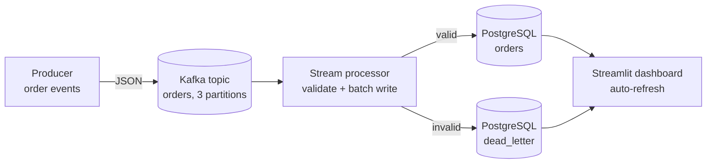

# Real-Time Data Pipeline with Streaming Ingestion and Live Dashboard

An end-to-end streaming analytics project. A producer emits e-commerce order events into **Apache Kafka**, a Python stream processor validates and loads them into **PostgreSQL**, and a **Streamlit** dashboard turns the data into live KPIs, charts and alerts that refresh every few seconds.

<!-- Add a screenshot or GIF of the dashboard here:  -->

## Problem Statement

Batch reporting leaves teams working with data that is hours old. This project shows how streaming ingestion plus a live dashboard cuts data latency from hours to seconds, while keeping bad data out of the analytics tables.

## Architecture



## Key Features

- **Streaming ingestion** with Kafka producers and a consumer group (3 partitions keyed by `user_id`)
- **Data contract and validation**: types, ranges, allowed values and timestamps are checked on every message
- **Dead-letter queue**: invalid messages are stored with the failure reason instead of being dropped
- **Reliable delivery**: offsets are committed only after the database commit (at-least-once), and inserts are idempotent (`ON CONFLICT DO NOTHING`), so duplicates and replays are harmless
- **Live dashboard**: KPIs, revenue and order trends, category/product/country breakdowns, latest orders
- **Operational alerts**: stalled stream, high invalid-message rate, high pipeline latency, sudden revenue drop
- **One-command setup** with Docker Compose, plus unit tests for validation, event generation and alert rules

## Tech Stack

Python 3.12, Apache Kafka (KRaft mode), PostgreSQL 16, SQL, Streamlit, Plotly, pandas, SQLAlchemy, Docker Compose, pytest

## Quick Start

Requirements: Docker with Docker Compose.

```bash
git clone https://github.com/<your-username>/real-time-data-pipeline.git
cd real-time-data-pipeline
docker compose up -d --build
```

Open the dashboard at **http://localhost:8501**. Data starts appearing within a few seconds.

```bash
make logs     # follow producer and consumer logs
make psql     # open a SQL shell on the analytics database
make down     # stop everything
make reset    # stop and delete stored data
```

Copy `.env.example` to `.env` to change traffic rate, invalid/duplicate rates or credentials.

## Running the Tests

```bash
python -m venv .venv && source .venv/bin/activate
pip install -r requirements-dev.txt
pytest -q
```

## Project Structure

```
├── common/
│   ├── config.py        # environment-based settings
│   └── schema.py        # event contract + validation
├── producer/
│   └── producer.py      # simulated order stream (with bad and duplicate messages)
├── consumer/
│   └── consumer.py      # Kafka -> validate -> PostgreSQL, manual offset commits
├── database/
│   └── schema.sql       # orders, dead_letter, orders_per_minute view
├── dashboard/
│   ├── app.py           # Streamlit app
│   └── alerts.py        # alert rules (unit-tested)
├── tests/
├── docker-compose.yml
├── Dockerfile
└── Makefile
```

## Design Decisions

| Decision | Why |
|---|---|
| Commit Kafka offsets after the DB commit | A crash can only cause a re-read, never data loss |
| `order_id` primary key + `ON CONFLICT DO NOTHING` | Makes redelivery and producer duplicates safe (effectively-once results) |
| Dead-letter table instead of dropping bad data | Data quality problems stay visible and debuggable |
| Batched inserts (`execute_values`) | Far fewer database round trips than row-by-row writes |
| Partition key = `user_id` | Keeps one user's events ordered while allowing parallel consumers |
| Track `event_time` and `ingested_at` | Lets the dashboard measure end-to-end pipeline latency |

## Useful SQL

```sql
-- Revenue and orders per minute (last 15 minutes)
SELECT * FROM orders_per_minute WHERE minute > now() - interval '15 minutes';

-- Most common validation failures
SELECT error_reason, count(*) FROM dead_letter GROUP BY 1 ORDER BY 2 DESC;

-- Average ingestion latency per minute
SELECT date_trunc('minute', ingested_at) AS minute,
       avg(extract(epoch FROM ingested_at - event_time)) AS latency_seconds
FROM orders GROUP BY 1 ORDER BY 1 DESC LIMIT 10;
```

## Configuration

| Variable | Default | Description |
|---|---|---|
| `EVENTS_PER_SECOND` | `5` | Average producer rate (varies +/-50% over time) |
| `INVALID_RATE` | `0.03` | Share of deliberately corrupted messages |
| `DUPLICATE_RATE` | `0.01` | Share of messages sent twice |
| `BATCH_SIZE` | `50` | Max messages per database batch |
| `BATCH_TIMEOUT_SECONDS` | `2` | Max wait to fill a batch |
| `POSTGRES_USER` / `POSTGRES_PASSWORD` / `POSTGRES_DB` | `pipeline` / `pipeline` / `analytics` | Database credentials |

## Troubleshooting

- **Dashboard shows "Waiting for the first events"**: check `make logs`; Kafka can take up to a minute to become healthy on first start.
- **Dashboard shows "Stream stalled"**: the producer or consumer stopped; run `docker compose ps` and `docker compose logs consumer`.
- **Port already in use**: change the `ports` mapping for `5432` or `8501` in `docker-compose.yml`.

## Business Impact

- Reduces data latency from hours to seconds
- Surfaces incidents (stalled streams, bad data, revenue drops) as they happen
- Protects analytics quality with validation and a reviewable dead-letter queue

## Future Improvements

- Anomaly detection on the live stream
- Schema Registry with Avro for enforced, versioned contracts
- Deploy to the cloud with managed Kafka and Postgres
- GitHub Actions CI to run tests and build the image on every push
- Prometheus and Grafana for infrastructure metrics
