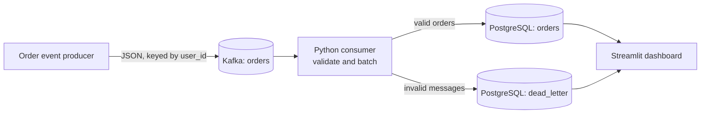

# Real-Time Data Pipeline with Streaming Ingestion and Live Dashboard


A runnable streaming analytics demo: a Python producer sends simulated e-commerce orders to Kafka, a consumer validates and stores them in PostgreSQL, and a Streamlit dashboard displays live metrics, charts, and data-quality alerts.

## Contents

- [Architecture](#architecture)
- [Features](#features)
- [Requirements](#requirements)
- [Run with Docker Compose](#run-with-docker-compose)
- [Services and ports](#services-and-ports)
- [Configuration](#configuration)
- [Useful commands](#useful-commands)
- [Data model](#data-model)
- [Run the tests](#run-the-tests)
- [Troubleshooting](#troubleshooting)
- [Deployment and security](#deployment-and-security)
- [Project structure](#project-structure)
- [License](#license)

## Architecture



1. The producer generates simulated orders at an adjustable rate. It deliberately sends a small number of invalid and duplicate messages.
2. The consumer validates messages, writes valid orders and rejected messages to PostgreSQL, then commits Kafka offsets.
3. The dashboard queries PostgreSQL and refreshes automatically.

The order ID and Kafka topic/partition/offset constraints make inserts idempotent. If the consumer restarts after a database commit but before committing Kafka offsets, a redelivered message does not create a duplicate row.

## Features

- Kafka running in single-node KRaft mode (no ZooKeeper).
- Event validation for required fields, types, ranges, allowed values, and timestamps.
- Dead-letter storage for invalid messages and their validation reasons.
- PostgreSQL analytics tables and an `orders_per_minute` view.
- Live dashboard for order and revenue KPIs, trends, category/product/country breakdowns, recent orders, and invalid messages.
- Alerts for a stalled stream, invalid-message rate, pipeline latency, and revenue drops.

### Dashboard alerts

| Alert | Trigger |
|---|---|
| Stream stalled | No order has been ingested for more than 30 seconds |
| High invalid-message rate | More than 10% of messages in the selected window fail validation |
| High pipeline latency | Average event-to-ingestion latency exceeds 10 seconds |
| Revenue drop | Revenue in the last five minutes is less than half of the previous five minutes |

## Requirements

- Docker Desktop on macOS/Windows, or Docker Engine with the Docker Compose plugin on Linux.
- Git, if cloning the repository.

The Docker setup builds the Python application image and runs all five services. You do not need to install Python or Kafka on the host to run the application with Compose.

## Run with Docker Compose

Clone the repository and start the services:

```bash
git clone https://github.com/theyashkhatri/Real-Time-Data-Pipeline-with-Streaming-Ingestion-and-Live-Dashboard.git
cd Real-Time-Data-Pipeline-with-Streaming-Ingestion-and-Live-Dashboard
docker compose up -d --build
```

The first build may take several minutes. Check the service status:

```bash
docker compose ps
```

Wait for Kafka and PostgreSQL to report healthy, then open **http://localhost:8501**. On the first start, Kafka may need up to a minute to become ready. The producer and consumer logs should show events being sent and processed:

```bash
docker compose logs -f producer consumer
```

## Services and ports

| Service | Purpose | Host address |
|---|---|---|
| `dashboard` | Streamlit live dashboard | [http://localhost:8501](http://localhost:8501) |
| `postgres` | Analytics database | `localhost:5432` |
| `kafka` | Kafka external listener for host-based clients | `localhost:29092` |
| `producer` | Simulated order-event producer | No host port |
| `consumer` | Kafka-to-PostgreSQL stream processor | No host port |

The producer and consumer connect to Kafka and PostgreSQL over the Compose network; their service names are used as hostnames.

## Configuration

Docker Compose reads optional settings from a `.env` file in the project root. Create one to override the defaults:

```dotenv
POSTGRES_USER=pipeline
POSTGRES_PASSWORD=replace-with-a-strong-password
POSTGRES_DB=analytics

EVENTS_PER_SECOND=5
INVALID_RATE=0.03
DUPLICATE_RATE=0.01
BATCH_SIZE=50
BATCH_TIMEOUT_SECONDS=2
KAFKA_TOPIC=orders
CONSUMER_GROUP=orders-processor
```

| Variable | Default | Description |
|---|---:|---|
| `POSTGRES_USER` | `pipeline` | PostgreSQL username |
| `POSTGRES_PASSWORD` | `pipeline` | PostgreSQL password; replace it outside local development |
| `POSTGRES_DB` | `analytics` | PostgreSQL database name |
| `EVENTS_PER_SECOND` | `5` | Approximate producer rate; it varies over time |
| `INVALID_RATE` | `0.03` | Fraction of generated messages that are intentionally invalid |
| `DUPLICATE_RATE` | `0.01` | Fraction of generated messages that are intentionally sent twice |
| `BATCH_SIZE` | `50` | Maximum messages consumed per batch |
| `BATCH_TIMEOUT_SECONDS` | `2` | Maximum time to wait for a batch |
| `KAFKA_TOPIC` | `orders` | Kafka topic name |
| `CONSUMER_GROUP` | `orders-processor` | Kafka consumer group |

After changing Compose environment values, recreate the affected services:

```bash
docker compose up -d
```

PostgreSQL initializes `database/schema.sql` only when its data directory is first created. Changing that SQL file does not automatically modify an existing database volume.

## Useful commands

```bash
docker compose ps                         # show service status
docker compose logs -f                    # follow all service logs
docker compose logs -f dashboard          # follow dashboard logs
docker compose logs -f producer consumer  # follow pipeline logs
docker compose restart                    # restart services
docker compose down                       # stop services, keep database data
```

Open a PostgreSQL shell using the configured container credentials:

```bash
docker compose exec postgres sh -c 'psql -U "$POSTGRES_USER" -d "$POSTGRES_DB"'
```

The database files are kept in a named Docker volume when you stop the stack. To remove the containers **and permanently delete the stored database data**, run:

```bash
docker compose down -v
```

## Data model

### Orders

Valid events are written to `orders`. Each row includes the order ID, user, product, category, quantity, unit price, computed total, country, payment method, status, event time, and ingestion time. `order_id` is the primary key, so duplicate orders are ignored.

Required event fields:

`order_id`, `user_id`, `product`, `category`, `quantity`, `unit_price`, `country`, `payment_method`, `status`, and `event_time`.

The validator requires positive integer user IDs, quantities from 1 to 20, unit prices greater than 0 and no more than 10,000, a two-letter country code, supported category/payment/status values, and an ISO-8601 event time no more than five minutes in the future.

### Dead letters and rollup

- `dead_letter` stores the Kafka topic, partition, offset, raw payload, and validation reason for rejected messages.
- `orders_per_minute` is a PostgreSQL view with per-minute order count, revenue, and average order value. The dashboard queries the base tables directly.

Example queries:

```sql
-- Recent per-minute rollups
SELECT *
FROM orders_per_minute
WHERE minute >= now() - interval '15 minutes'
ORDER BY minute DESC;

-- Most common validation failures
SELECT error_reason, count(*)
FROM dead_letter
GROUP BY error_reason
ORDER BY count(*) DESC;

-- Average ingestion latency by minute
SELECT date_trunc('minute', ingested_at) AS minute,
       avg(extract(epoch FROM ingested_at - event_time)) AS latency_seconds
FROM orders
GROUP BY 1
ORDER BY 1 DESC
LIMIT 10;
```

## Run the tests

The test suite can run on the host with Python 3.12:

```bash
python3 -m venv .venv
source .venv/bin/activate
python -m pip install -r requirements-dev.txt
pytest -q
```

The tests cover event validation, generated and corrupted producer events, and alert rules.

## Troubleshooting

| Symptom | What to check |
|---|---|
| `docker: command not found` | Install and start Docker Desktop (macOS/Windows), or install Docker Engine and the Compose plugin (Linux). |
| Dashboard does not open | Confirm `docker compose ps` shows `dashboard` running; inspect `docker compose logs --tail=100 dashboard`. |
| Dashboard says it is waiting for events | Kafka may still be starting. Check `docker compose ps` and `docker compose logs --tail=100 kafka producer consumer`. |
| Dashboard reports database unavailable | Check that `postgres` is healthy with `docker compose ps`; inspect `docker compose logs --tail=100 postgres`. |
| Stream appears stalled | Check producer/consumer status and logs with `docker compose logs --tail=100 producer consumer`. |
| Port is already in use | Change the relevant host port mapping in `docker-compose.yml`, then run `docker compose up -d`. |
| Schema changes do not appear | The initialization SQL runs only for a new PostgreSQL data directory. Back up any data before resetting the volume. |
| Need to start over | `docker compose down -v` removes the database volume and all stored data. |

## Deployment and security

This Compose configuration is intended for local development and single-host demonstrations. It runs one Kafka broker and maps the dashboard, PostgreSQL, and Kafka ports to the host. The default database credentials are not suitable for a public deployment.

Before making a deployment reachable outside your machine:

- Set a strong, unique PostgreSQL password in `.env`.
- Restrict PostgreSQL (`5432`) and Kafka (`29092`) access with the host firewall; do not expose them publicly unless you have a specific, secured use case.
- Serve the dashboard through HTTPS, typically using a reverse proxy, rather than exposing an unencrypted public endpoint.
- Keep the PostgreSQL data volume persistent and back it up.
- For production, use appropriately secured and highly available Kafka and PostgreSQL deployments; this single-broker Compose setup is not highly available.

## Project structure

```text
common/
  config.py          Environment-based application settings
  schema.py          Order event contract and validation
producer/
  producer.py        Simulated Kafka event producer
consumer/
  consumer.py        Kafka consumer and PostgreSQL writer
database/
  schema.sql         PostgreSQL tables, indexes, and rollup view
dashboard/
  app.py             Streamlit dashboard
  alerts.py          Operational alert rules
tests/               Unit tests
Dockerfile
docker-compose.yml
Makefile
requirements.txt
requirements-dev.txt
```

## License

This project is released under the [MIT License](LICENSE).
