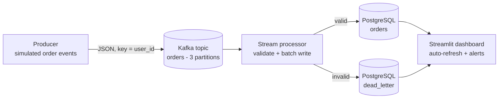

# Real-Time Data Pipeline with Streaming Ingestion and Live Dashboard


An end-to-end streaming analytics project. A producer emits e-commerce order events into **Apache Kafka**, a Python stream processor validates them and loads **PostgreSQL**, and a **Streamlit** dashboard turns the data into live KPIs, charts and operational alerts that refresh every few seconds.

<!-- Add a screenshot or GIF of the running dashboard, then uncomment:

-->

## Table of Contents

- [Why This Project](#why-this-project)
- [Architecture](#architecture)
- [Key Features](#key-features)
- [Tech Stack](#tech-stack)
- [Quick Start](#quick-start)
- [What You'll See](#what-youll-see)
- [Data Model](#data-model)
- [Data Quality and Reliability](#data-quality-and-reliability)
- [Alerts](#alerts)
- [Configuration](#configuration)
- [Project Structure](#project-structure)
- [Testing](#testing)
- [Useful SQL](#useful-sql)
- [Troubleshooting](#troubleshooting)
- [Skills Demonstrated](#skills-demonstrated)
- [Future Improvements](#future-improvements)
- [License](#license)

## Why This Project

Batch reporting leaves teams working with data that is hours old. This project shows the streaming alternative: events are ingested continuously, validated on arrival, stored in an analytics database and visualised within seconds. It also treats data quality as a first-class concern, so bad data is quarantined and visible instead of silently corrupting the numbers.

## Architecture



**Data flow**

1. The **producer** generates order events at an average rate that rises and falls over time. A small share of messages is deliberately corrupted or duplicated to exercise the downstream safeguards.
2. The **consumer** reads batches from Kafka, validates every message against the event contract, and writes valid orders and rejected messages to PostgreSQL in one transaction.
3. Only after that transaction commits does the consumer commit its Kafka offsets.
4. The **dashboard** queries PostgreSQL and re-renders on a configurable interval.

## Key Features

- **Streaming ingestion** with Kafka producers and a consumer group; the topic has 3 partitions keyed by `user_id`
- **Data contract and validation** on every message: types, ranges, allowed values and timestamps
- **Dead-letter table** that stores each rejected message with the reason it failed
- **Reliable delivery**: offsets are committed after the database commit (at-least-once), and inserts are idempotent, so redelivered or duplicated messages never create duplicate rows
- **Live dashboard** with KPIs, revenue and order trends, category, product and country breakdowns, latest orders and the dead-letter queue
- **Operational alerts** for a stalled stream, a high invalid-message rate, high pipeline latency and sudden revenue drops
- **One-command setup** with Docker Compose and unit tests for validation, event generation and alert rules

## Tech Stack

| Layer | Technology |
|---|---|
| Streaming | Apache Kafka 3.8 (KRaft mode, no ZooKeeper), `confluent-kafka` |
| Processing | Python 3.12 |
| Storage | PostgreSQL 16 |
| Dashboard | Streamlit, Plotly, pandas, SQLAlchemy |
| Infrastructure | Docker, Docker Compose |
| Testing | pytest |

## Quick Start

**Requirements:** Docker with Docker Compose.

```bash
git clone https://github.com/theyashkhatri/Real-Time-Data-Pipeline-with-Streaming-Ingestion-and-Live-Dashboard.git
cd Real-Time-Data-Pipeline-with-Streaming-Ingestion-and-Live-Dashboard
docker compose up -d --build
```

Open the dashboard at **http://localhost:8501**. Data should start appearing within a few seconds; on a first start Kafka can take up to a minute to become healthy.

| Service | Address |
|---|---|
| Dashboard | http://localhost:8501 |
| PostgreSQL | `localhost:5432` (user `pipeline`, password `pipeline`, database `analytics`) |
| Kafka (from your host) | `localhost:29092` |

Handy commands (see the `Makefile`):

```bash
make logs     # follow producer and consumer logs
make psql     # open a SQL shell on the analytics database
make down     # stop all services
make reset    # stop all services and delete stored data
```

To change traffic volume, invalid or duplicate rates, or credentials, copy `.env.example` to `.env` and edit it before starting.

## What You'll See

| Dashboard section | What it shows |
|---|---|
| Alert banner | Green when healthy; warnings or errors when a rule below is triggered |
| KPI row | Orders, revenue, average order value, orders in the last minute, invalid messages |
| Pipeline latency | Average time from event creation to being stored |
| Trend charts | Revenue per minute and orders per minute |
| Breakdowns | Revenue by category, top 5 products, orders by country |
| Latest orders | The 15 most recent orders |
| Dead-letter queue | The latest invalid messages with the reason each was rejected |

Use the sidebar to choose the time window (5, 15, 30 or 60 minutes) and the refresh interval. Revenue excludes cancelled orders.

## Data Model

**Event contract** (JSON message on the `orders` topic):

| Field | Rule |
|---|---|
| `order_id` | Non-empty string, up to 64 characters; unique per order |
| `user_id` | Positive integer |
| `product` | Non-empty string |
| `category` | One of `Electronics`, `Home`, `Fashion`, `Books`, `Sports`, `Beauty` |
| `quantity` | Integer from 1 to 20 |
| `unit_price` | Number greater than 0 and at most 10,000 |
| `country` | 2-letter code (stored upper-case) |
| `payment_method` | One of `card`, `upi`, `paypal`, `bank_transfer`, `wallet` |
| `status` | One of `completed`, `pending`, `cancelled` |
| `event_time` | ISO-8601 timestamp, not more than 5 minutes in the future; stored as UTC |

**Tables** (defined in `database/schema.sql`):

- `orders`: validated orders, with `order_id` as the primary key, a computed `total_amount`, the order's `event_time` and the pipeline's `ingested_at`
- `dead_letter`: rejected messages with Kafka topic, partition and offset, the raw payload and the error reason
- `orders_per_minute`: a view that rolls orders up per minute for ad-hoc analysis

## Data Quality and Reliability

| Decision | Why |
|---|---|
| Commit Kafka offsets only after the database commit | A crash can cause a re-read but never data loss |
| `order_id` primary key with `ON CONFLICT DO NOTHING` | Producer duplicates and redeliveries are harmless, so results are effectively exactly-once |
| Dead-letter table instead of dropping bad messages | Quality problems stay visible and debuggable; replays of the same Kafka offset are ignored |
| Batched inserts with `execute_values` | Far fewer database round trips than row-by-row writes |
| Partition key = `user_id` | Keeps each user's events ordered while allowing parallel consumers |
| Track both `event_time` and `ingested_at` | Allows end-to-end pipeline latency to be measured |
| Exit on database failure and let Docker restart | The consumer group resumes from the last committed offset, so nothing is skipped |

## Alerts

| Alert | Level | Triggers when |
|---|---|---|
| Stream stalled | Error | No new order has been ingested for more than 30 seconds |
| High invalid-message rate | Warning | More than 10% of messages in the window failed validation |
| High pipeline latency | Warning | Average latency exceeds 10 seconds |
| Revenue drop | Warning | Revenue in the last 5 minutes is below 50% of the previous 5 minutes |

Thresholds live in `dashboard/alerts.py`.

## Configuration

All settings are environment variables with defaults (see `.env.example`).

| Variable | Default | Description |
|---|---|---|
| `EVENTS_PER_SECOND` | `5` | Average producer rate (varies by about +/-50% over time) |
| `INVALID_RATE` | `0.03` | Share of deliberately corrupted messages |
| `DUPLICATE_RATE` | `0.01` | Share of messages sent twice |
| `BATCH_SIZE` | `50` | Maximum messages per database batch |
| `BATCH_TIMEOUT_SECONDS` | `2` | Maximum wait to fill a batch |
| `KAFKA_TOPIC` | `orders` | Topic name |
| `CONSUMER_GROUP` | `orders-processor` | Kafka consumer group |
| `POSTGRES_USER` / `POSTGRES_PASSWORD` / `POSTGRES_DB` | `pipeline` / `pipeline` / `analytics` | Database credentials |

The default credentials are for local development only; change them before exposing the stack anywhere.

## Project Structure

```
├── common/
│   ├── config.py          # environment-based settings
│   └── schema.py          # event contract and validation
├── producer/
│   └── producer.py        # simulated order stream (with bad and duplicate messages)
├── consumer/
│   └── consumer.py        # Kafka -> validate -> PostgreSQL, manual offset commits
├── database/
│   └── schema.sql         # orders, dead_letter, orders_per_minute view
├── dashboard/
│   ├── app.py             # Streamlit app
│   └── alerts.py          # alert rules (unit-tested)
├── tests/                 # pytest suite
├── docker-compose.yml
├── Dockerfile
├── Makefile
└── requirements.txt
```

## Testing

```bash
python -m venv .venv && source .venv/bin/activate
pip install -r requirements-dev.txt
pytest -q
```

The tests cover event validation (valid, malformed and boundary cases), the producer's generators (every generated event is valid and every corrupted one is rejected) and the alert rules.

## Useful SQL

```sql
-- Revenue and orders per minute (last 15 minutes)
SELECT * FROM orders_per_minute WHERE minute > now() - interval '15 minutes';

-- Most common validation failures
SELECT error_reason, count(*) FROM dead_letter GROUP BY 1 ORDER BY 2 DESC;

-- Average ingestion latency per minute
SELECT date_trunc('minute', ingested_at) AS minute,
       avg(extract(epoch FROM ingested_at - event_time)) AS latency_seconds
FROM orders GROUP BY 1 ORDER BY 1 DESC LIMIT 10;

-- Revenue by country, excluding cancelled orders
SELECT country, sum(total_amount) AS revenue
FROM orders WHERE status <> 'cancelled' GROUP BY 1 ORDER BY 2 DESC;
```

## Troubleshooting

| Symptom | What to check |
|---|---|
| Dashboard says it is waiting for the first events | Run `make logs`; Kafka may still be starting on a first run |
| "Stream stalled" alert | The producer or consumer stopped; run `docker compose ps` and `docker compose logs consumer` |
| "Database unavailable" message | PostgreSQL is still starting or down; the dashboard retries on every refresh |
| Port already in use | Change the `5432` or `8501` mapping under `ports` in `docker-compose.yml` |
| Want a clean slate | Run `make reset` to remove containers and stored data |

## Skills Demonstrated

- Designing an event-driven architecture and a data contract
- Stream processing with Kafka consumer groups, partitioning and manual offset management
- Building idempotent, fault-tolerant ingestion with a dead-letter pattern
- SQL schema design, indexing and analytical queries
- Operational monitoring: freshness, latency and data-quality alerts
- Building interactive dashboards with Streamlit and Plotly
- Containerised, reproducible environments with Docker Compose
- Writing unit tests for validation and business rules

## Future Improvements

- Anomaly detection on the live stream
- Schema Registry with Avro for enforced, versioned contracts
- Deployment to the cloud with managed Kafka and PostgreSQL
- GitHub Actions CI to run tests and build the image on every push
- Prometheus and Grafana for infrastructure metrics

## License

Released under the [MIT License](LICENSE).
